# PENETRATION TESTING REPORT: FOOTPRINTING & NETWORK SCANNING PHASES (`W2-PM-FINAL`)

**CYBERSECURITY & ETHICAL HACKING INTERNSHIP | NETWORKWALKS ACADEMY**

| Attribute | Details |
| :--- | :--- |
| **Pentester Name (Cybersecurity Professional)** | **Angga Yoga Syahputra** |
| **Program / Batch** | **B084-Networkwalks** |
| **Date** | **11 November 2026** |
| **Modules Completed** | **W2-PM1** (Multiple Kali Tools)<br>**W2-PM2** (GHDB Based Footprinting Attacks)<br>**W2-PM3** (Maltego Based Footprinting Attacks)<br>**W2-PM4** (theHarvester Based Footprinting Attacks)<br>**W2-PM5** (Zenmap Network Scanning) |
| **Client / Target** | 1. **Networkwalks** (`networkwalks.com` — secured written permission already)<br>2. **My own local LAN Network** (`192.168.100.0/24`) |
| **Permission Secured from Client?** | **Yes** (Formal Letter of Authorization / Liability Waiver) |
| **Phases Covered** | **Phase 1:** Reconnaissance & Footprinting (`W2-PM1` to `W2-PM4`)<br>**Phase 2:** Scanning & Network Discovery (`W2-PM5`)<br>**Phases 3–5:** In Progress |

---

## 1. Liability Disclaimer

I have performed these activities only on the systems and devices where I had secured written permission or the devices/systems that I own myself. All these materials are for educational and research purposes only. Do not use anything from here to break the law. The instructor, the authors, and Networkwalks are not responsible for what you do with this knowledge. Every action you take is your own responsibility. Misuse can lead to criminal charges, heavy fines, loss of your job, and a permanent record. In most countries, unauthorized access is a crime even when nothing is damaged.

---

## 2. Introduction

This report documents the comprehensive execution of all five Week 2 project modules (**W2-PM1 through W2-PM5**) covering **Phase 1 (Footprinting & Reconnaissance)** and **Phase 2 (Network Scanning & Host Discovery)** as part of my ongoing Cybersecurity & Ethical Hacking Internship at Networkwalks (Batch B084).

- In **Phase 1 (Footprinting & Reconnaissance)**, I performed passive and light open-source intelligence (OSINT) gathering against the authorized target domain `networkwalks.com` using six native Kali Linux tools (**W2-PM1**), advanced Google Dorking via the Google Hacking Database (**W2-PM2**), visual entity link analysis using Maltego Graph (**W2-PM3**), and multi-source email/subdomain enumeration using theHarvester (**W2-PM4**).
- In **Phase 2 (Network Scanning & Discovery)**, I transitioned from external reconnaissance to internal active network discovery across my local area network (`192.168.100.0/24`) using Windows Command Prompt and Zenmap GUI (**W2-PM5**).

Together, these five modules demonstrate the complete methodology an attacker or penetration tester follows when progressing from passive public intelligence gathering to mapping live hosts, hardware vendors, and network topology. Every task below includes the exact command or query executed, observed technical outputs, raw text logs, visual screenshot evidence, and an analysis of why each finding matters from an attacker's perspective.

---

## 3. Tools Used

The table below lists each operating system and security tool utilized across Modules 1 through 5 and its specific technical purpose:

| Tool | Module | Purpose |
| :--- | :---: | :--- |
| **Kali Linux (Oracle VirtualBox VM) & Windows Host** | All | Primary operating system environments used for passive reconnaissance and active network discovery. |
| **`whois`** | W2-PM1 | Query public domain registration databases for registrar details, registration/expiry dates, domain status flags, name servers, and DNSSEC status. |
| **`whatweb`** | W2-PM1 | Fingerprint web server software, Content Management System (CMS) versions, active plugins, front-end libraries, cookies, IP geolocation, and exposed emails. |
| **`nslookup`** | W2-PM1 | Resolve the target domain name (`networkwalks.com`) to its underlying IPv4 address via DNS queries. |
| **`curl -I`** | W2-PM1 | Fetch and inspect HTTP response headers, server banners, caching layers, security cookies, and exposed REST API endpoints. |
| **`wafw00f`** | W2-PM1 | Detect and fingerprint the Web Application Firewall (WAF) protecting the target web application. |
| **`dnsrecon`** | W2-PM1 | Perform comprehensive DNS record enumeration (`SOA`, `NS`, `MX`, `A`, `TXT`/`SPF`, `SRV`, and `BIND` version). |
| **Exploit-DB (GHDB) & Google Search** | W2-PM2 | Leverage curated Google Hacking Database (GHDB) search operators (`intitle:`, `inurl:`, `intext:`) to locate live unauthenticated IP cameras and open PDF directories. |
| **Maltego Graph (Desktop) 4.13.0 CE** | W2-PM3 | Perform visual OSINT entity relationship mapping and run automated transforms (`[Utilities] To Emails @domain [Search Engine]`) on Kali Linux. |
| **`theHarvester` (v4.11.1)** | W2-PM4 | Harvest organizational email addresses, subdomains, virtual hosts, and IPv4/IPv6 addresses from public search engines (`baidu`, `all`). |
| **Windows CMD (`ipconfig` / `ipconfig /all`)** | W2-PM5 | Identify the local machine's IPv4 address (`192.168.100.3`), subnet mask (`/24`), default gateway (`192.168.100.1`), and local physical MAC address. |
| **Zenmap (Nmap v7.99 GUI)** | W2-PM5 | Execute active ICMP/ARP Ping Scans (`nmap -sn 192.168.100.0/24`) to discover live hosts, IP addresses, MAC OUI vendors, and radial network topology diagrams. |

---

## 4. Activities Performed

### 4.1 Phase 1: Footprinting & Reconnaissance

#### 4.1.1 Footprinting with Multiple Kali Tools (`W2-PM1`)

I performed passive and light footprinting against `networkwalks.com` using six Kali Linux command-line tools. All raw terminal outputs are archived in the [`outputs_w2pm1/`](./outputs_w2pm1/) directory.

---

##### Task 1: Domain Registration Reconnaissance with `whois`
- **Command Executed:**
  ```bash
  whois networkwalks.com
  ```
- **Raw Output Log:** [`outputs_w2pm1/01_whois.txt`](./outputs_w2pm1/01_whois.txt)
- **Key Findings Observed:**
  - **Domain Name:** `NETWORKWALKS.COM` (`Registry Domain ID: 2452319255_DOMAIN_COM-VRSN`)
  - **Registrar:** `GoDaddy.com, LLC` (`WHOIS Server: whois.godaddy.com`, `IANA ID: 146`)
  - **Important Dates:** Created on `2019-11-06T22:51:46Z`, Updated on `2025-11-12T10:08:43Z`, Expires on `2027-11-06T22:51:46Z`
  - **Domain Status Flags:** `clientDeleteProhibited`, `clientRenewProhibited`, `clientTransferProhibited`, `clientUpdateProhibited`
  - **Name Servers:** `NS6135.HOSTGATOR.COM` and `NS6136.HOSTGATOR.COM`
  - **DNSSEC Status:** `unsigned`
- **Why This Matters to an Attacker:** WHOIS reveals the registrar (GoDaddy) and hosting provider via Name Servers (HostGator). Furthermore, `DNSSEC: unsigned` indicates that DNS responses are not cryptographically signed, increasing susceptibility to DNS spoofing or cache poisoning.
- **Evidence Screenshot (`01_whois.png`):**
  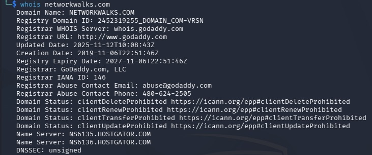

---

##### Task 2: Web Technology Fingerprinting with `whatweb`
- **Command Executed:**
  ```bash
  whatweb networkwalks.com
  ```
- **Raw Output Log:** [`outputs_w2pm1/02_whatweb.txt`](./outputs_w2pm1/02_whatweb.txt)
- **Key Findings Observed:**
  - **HTTP Redirect Chain:** `http://networkwalks.com [301 Moved Permanently]` redirects to `https://networkwalks.com/ [200 OK]`
  - **Server & Hosting IP:** `Apache` web server hosted on `192.232.216.135` (`UNITED STATES`)
  - **CMS & Version:** `WordPress 7.1.4` (exposed via `MetaGenerator` and fingerprint tags)
  - **Active Plugin:** `WordPress Download Manager 3.3.76` (with session cookie `_wpdm_client`)
  - **Front-End Libraries:** `Bootstrap [7.1.4]`, `JQuery [3.7.1]`, `HTML5`
  - **Exposed Organizational Email:** `info@networkwalks.com`
- **Why This Matters to an Attacker:** Exact software version numbers (`WordPress 7.1.4` and `WP Download Manager 3.3.76`) allow attackers to look up version-specific CVEs and public exploits rather than launching blind attacks.
- **Evidence Screenshot (`02_whatweb.png`):**
  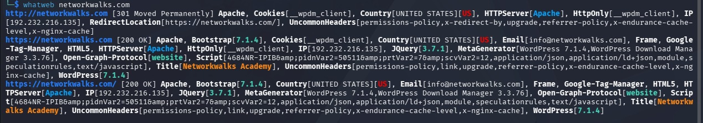

---

##### Task 3: DNS Name Resolution with `nslookup`
- **Command Executed:**
  ```bash
  nslookup networkwalks.com
  ```
- **Raw Output Log:** [`outputs_w2pm1/03_nslookup.txt`](./outputs_w2pm1/03_nslookup.txt)
- **Key Findings Observed:**
  - **Non-Authoritative Answer:** Resolves `networkwalks.com` directly to IPv4 address `192.232.216.135`.
- **Why This Matters to an Attacker:** Identifying the underlying server IP (`192.232.216.135`) enables direct port scanning, reverse IP lookups to find co-hosted websites on the same shared server, and infrastructure mapping.
- **Evidence Screenshot (`03_nslookup.png`):**
  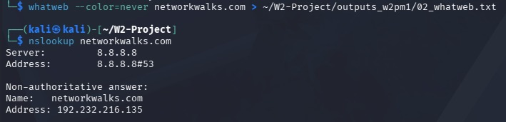

---

##### Task 4: HTTP Response Header Inspection with `curl`
- **Command Executed:**
  ```bash
  curl -I https://networkwalks.com
  ```
- **Raw Output Log:** [`outputs_w2pm1/04_curl.txt`](./outputs_w2pm1/04_curl.txt)
- **Key Findings Observed:**
  - **HTTP Status & Server:** `HTTP/2 200` served by `server: Apache`
  - **Exposed REST API Endpoints:** `link: <https://networkwalks.com/wp-json/>; rel="https://api.w.org/"` and `<https://networkwalks.com/wp-json/wp/v2/pages/53>`
  - **Session Cookie Security Flags:** `set-cookie: _wpdm_client=...; path=/; domain=networkwalks.com; secure; HttpOnly`
  - **Caching Architecture:** `x-endurance-cache-level: 0` and `x-nginx-cache: WordPress`
- **Why This Matters to an Attacker:** The exposed `/wp-json/` REST API endpoint can be queried by attackers to enumerate registered WordPress users, extract post/page metadata, or test plugin API vulnerabilities.
- **Evidence Screenshot (`04_curl.png`):**
  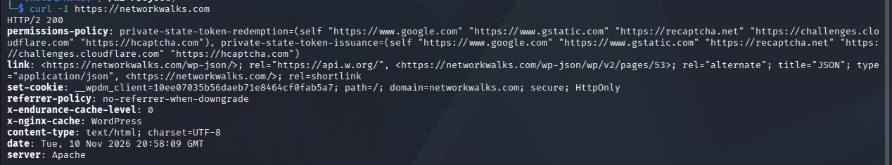

---

##### Task 5: Web Application Firewall (WAF) Detection with `wafw00f`
- **Command Executed:**
  ```bash
  wafw00f networkwalks.com
  ```
- **Raw Output Log:** [`outputs_w2pm1/05_wafw00f.txt`](./outputs_w2pm1/05_wafw00f.txt)
- **Key Findings Observed:**
  - **WAF Detected:** `[+] The site https://networkwalks.com is behind ModSecurity (SpiderLabs) WAF.`
  - **Requests Sent:** `2`
- **Why This Matters to an Attacker:** Knowing that `ModSecurity (SpiderLabs)` is active warns an attacker that noisy automated scanners will be blocked or logged, prompting them to use rate-limiting, encoding, or WAF-bypass techniques.
- **Evidence Screenshot (`05_wafw00f.png`):**
  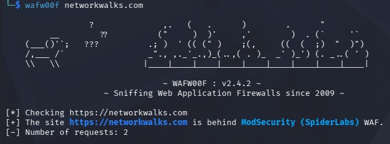

---

##### Task 6: Comprehensive DNS Enumeration with `dnsrecon`
- **Command Executed:**
  ```bash
  dnsrecon -d networkwalks.com
  ```
- **Raw Output Log:** [`outputs_w2pm1/06_dnsrecon.txt`](./outputs_w2pm1/06_dnsrecon.txt)
- **Key Findings Observed:**
  - **DNSSEC:** `[-] DNSSEC is not configured for networkwalks.com`
  - **SOA & NS Records:** `ns6135.hostgator.com` (`50.87.144.87`) and `ns6136.hostgator.com` (`192.232.216.131`)
  - **DNS Software Version Disclosed:** `Bind Version for 50.87.144.87 9.16.23-RH` and `Bind Version for 192.232.216.131 9.16.23-RH`
  - **Mail Exchange (MX) & A Records:** `mail.networkwalks.com` -> `192.232.216.135`; `A networkwalks.com` -> `192.232.216.135`
  - **TXT / SPF Records:** `v=spf1 a mx include:websitewelcome.com ~all` (SoftFail `~all`) and `google-site-verification` token
  - **SRV Records:** 8 `_autodiscover._tcp.networkwalks.com` records pointing to `cpanelemaildiscovery.cpanel.net` on port `443` (confirming cPanel management)
- **Why This Matters to an Attacker:** Disclosing `BIND 9.16.23-RH`, cPanel autodiscover endpoints, and an SPF SoftFail (`~all`) policy gives attackers actionable intelligence for targeting DNS services, cPanel login portals, or email spoofing.
- **Evidence Screenshot (`06_dnsrecon.png`):**
  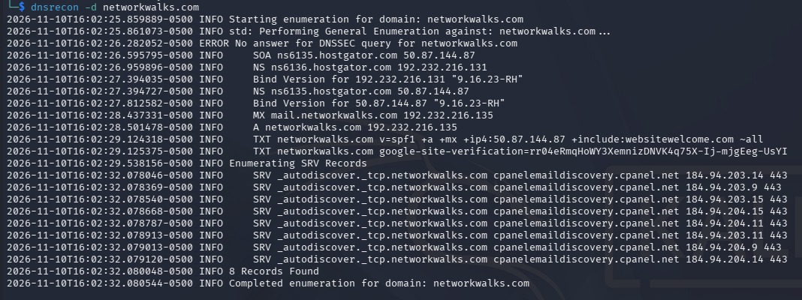

---

#### 4.1.2 GHDB Based Footprinting Attacks (`W2-PM2`)

In the second module (**W2-PM2**), I utilized the **Google Hacking Database (GHDB)** hosted on [https://www.exploit-db.com/google-hacking-database](https://www.exploit-db.com/google-hacking-database) to perform passive search engine reconnaissance using advanced Google operators (`intitle:`, `inurl:`, `intext:`).

##### Task 1: Discovering 10x Live Vulnerable Security Cameras
1. I accessed the GHDB portal on Exploit-DB and filtered the database using the keyword `cam` in the Quick Search bar.
2. Using curated camera dorks from GHDB (`intitle:"webcamXP" inurl:8080`, `"my webcamXP server!"`, `intitle:"Live View / - AXIS"`, `inurl:/view/index.shtml`, and `inurl:"MultiCameraFrame?Mode=Motion"`), I located and verified 10 live, unauthenticated security camera web interfaces streaming in real time (including primary verified target `http://109.233.191.130:8080/` running `WEBCAMXP 5` with `Not logged in` status and `http://www.insecam.org/en/bytype/WebcamXP/`).

| No. | Live Vulnerable Camera Link | Relevant Google Dork | Username / Password (if any) |
| :---: | :--- | :--- | :--- |
| 1 | [http://122.116.41.8:8080/](http://122.116.41.8:8080/) | `intitle:"webcamXP" inurl:8080` | None (Unauthenticated / Not logged in) |
| 2 | [http://109.233.191.130:8080/](http://109.233.191.130:8080/) | `intitle:"webcamXP" inurl:8080` | None (Unauthenticated — Verified in Screenshots 08 & 09) |
| 3 | [http://99.132.182.35:8080/](http://99.132.182.35:8080/) | `intitle:"webcamXP" inurl:8080` | None (Unauthenticated / Not logged in) |
| 4 | [http://104.177.153.145:8080/](http://104.177.153.145:8080/) | `intitle:"webcamXP" inurl:8080` | None (Unauthenticated / Not logged in) |
| 5 | [http://www.insecam.org/en/bytype/WebcamXP/](http://www.insecam.org/en/bytype/WebcamXP/) | `intitle:"webcamXP" inurl:8080` | None (Unauthenticated WebcamXP Live Index) |
| 6 | [http://camarasmarmolw7.zapto.org:8080/gallery](http://camarasmarmolw7.zapto.org:8080/gallery) | `"my webcamXP server!"` | None (Unauthenticated / Public View) |
| 7 | [http://131.95.3.162/view/view.shtml](http://131.95.3.162/view/view.shtml) | `intitle:"Live View / - AXIS"` | None (Unauthenticated / Public Feed) |
| 8 | [http://195.228.161.126/view/index.shtml](http://195.228.161.126/view/index.shtml) | `inurl:/view/index.shtml` | None (Unauthenticated / Public Feed) |
| 9 | [http://210.156.143.92/view/view.shtml](http://210.156.143.92/view/view.shtml) | `intitle:"LiveView / - AXIS" \| inurl:view/view.shtml` | None (Unauthenticated / Public Feed) |
| 10 | [http://118.21.142.194/MultiCameraFrame?Mode=Motion](http://118.21.142.194/MultiCameraFrame?Mode=Motion) | `inurl:"MultiCameraFrame?Mode=Motion"` | None (Unauthenticated / Motion Mode) |

- **Evidence Screenshots (`07_ghdb_exploitdb.png`, `08_ghdb_cam_search.png`, `09_ghdb_cam_live.jpg`):**
  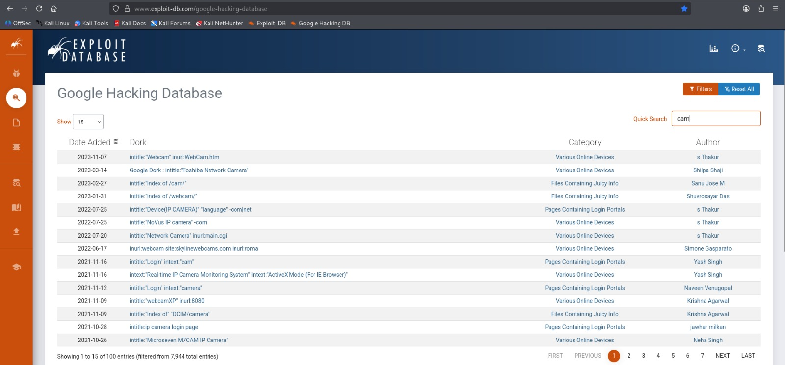
  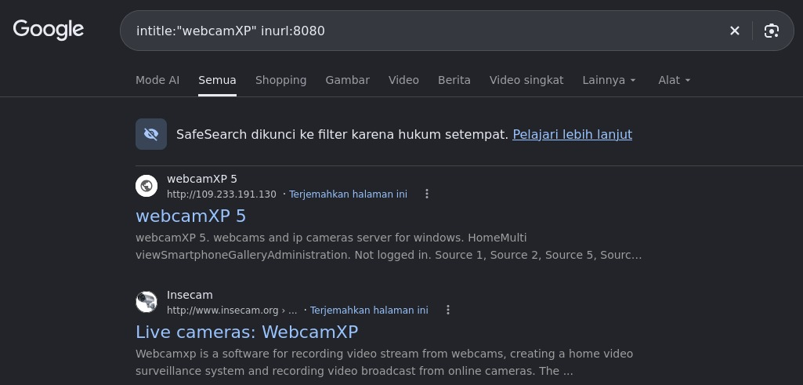
  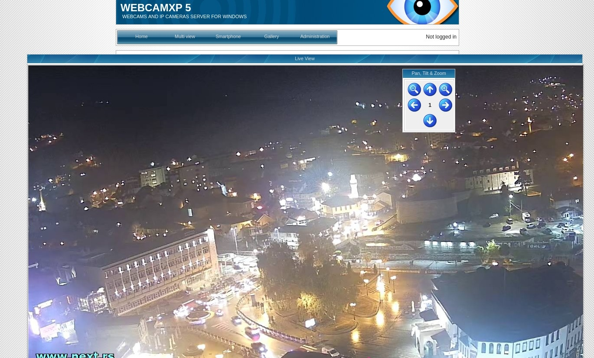

---

##### Task 2: Enumerating 10x Open Directory Listings Containing Downloadable Mathematics PDF Ebooks
1. I executed open directory indexing dorks starting with `intitle:index.of "parent directory" mathematics pdf` and related academic repository variations.
2. I verified 10 web servers with directory browsing enabled (`Index of /`), exposing downloadable mathematics PDF textbooks and lecture notes (including primary verified repository `http://erewhon.superkuh.com/library/Math/`).

| No. | Open Directory Listing Link | Relevant Google Dork | Username / Password (if any) |
| :---: | :--- | :--- | :--- |
| 1 | [https://www.skylineuniversity.ac.ae/pdf/math/](https://www.skylineuniversity.ac.ae/pdf/math/) | `intitle:index.of "parent directory" mathematics pdf` | None (Public Directory Listing) |
| 2 | [http://erewhon.superkuh.com/library/Math/](http://erewhon.superkuh.com/library/Math/) | `intitle:index.of "parent directory" mathematics pdf` | None (Public Directory Listing — Verified in Screenshot 10) |
| 3 | [https://www.cuteboyprogrammers.com/pdf/Math/](https://www.cuteboyprogrammers.com/pdf/Math/) | `intitle:index.of "parent directory" mathematics pdf` | None (Public Directory Listing) |
| 4 | [https://carma.newcastle.edu.au/brailey/Lecture_Notes/](https://carma.newcastle.edu.au/brailey/Lecture_Notes/) | `intitle:index.of "parent directory" mathematics pdf` | None (Public Directory Listing) |
| 5 | [https://www.homeschoolmath.net/teaching/pdfs/](https://www.homeschoolmath.net/teaching/pdfs/) | `intitle:index.of "parent directory" mathematics pdf` | None (Public Directory Listing) |
| 6 | [https://people.math.sc.edu/howard/Classes/554b/](https://people.math.sc.edu/howard/Classes/554b/) | `intitle:"index of" "parent directory" mathematics pdf` | None (Public Directory Listing) |
| 7 | [https://www.math.uh.edu/~vern/3333/](https://www.math.uh.edu/~vern/3333/) | `intitle:"index of" "parent directory" "math" pdf` | None (Public Directory Listing) |
| 8 | [https://www.math.upenn.edu/~deturck/m104/](https://www.math.upenn.edu/~deturck/m104/) | `intitle:"index of" "parent directory" "calculus" pdf` | None (Public Directory Listing) |
| 9 | [https://people.math.harvard.edu/~knill/teaching/math21b2019/handouts/](https://people.math.harvard.edu/~knill/teaching/math21b2019/handouts/) | `intitle:"index of" "parent directory" "linear algebra" pdf` | None (Public Directory Listing) |
| 10 | [https://math.mit.edu/~gs/linearalgebra/](https://math.mit.edu/~gs/linearalgebra/) | `intitle:"index of" "parent directory" "linear algebra" pdf` | None (Public Directory Listing) |

- **Why This Matters to an Attacker:** Search engine dorking is completely passive because queries hit Google's index rather than the target servers. Unauthenticated IoT cameras expose physical facilities and vulnerable firmware, while enabled directory listings (`Index of /`) can inadvertently leak sensitive archives, backups, or internal documents.
- **Evidence Screenshot (`10_ghdb_math_pdf.jpg`):**
  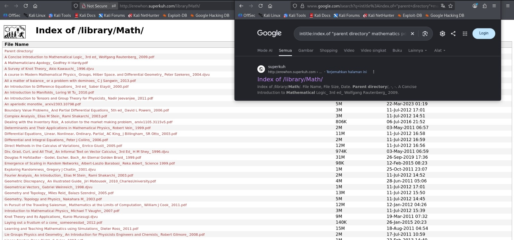

---

#### 4.1.3 Maltego Based Footprinting Attacks (`W2-PM3`)

In the third module (**W2-PM3**), I conducted visual OSINT link analysis and entity relationship mapping against `networkwalks.com` using **Maltego Graph (Desktop) 4.13.0 (Community Edition)** inside Kali Linux:

1. **Installation & Transform Hub Setup in Kali Linux (Task 1):** I installed and launched Maltego in Kali Linux (`sudo apt install -y maltego`), completed browser authentication for Maltego CE, and installed the **Utilities** Transform Hub package.
2. **Domain Entity Configuration & Email Harvesting (Task 2):**
   - I created a new investigation graph (`New Graph (1)`), searched for `domain` in the *Entity Palette*, dragged a **Domain** entity (`[maltego.Domain]`) onto the canvas, and set its `Domain Name` property to `networkwalks.com`.
   - I right-clicked the `networkwalks.com` node, executed the **`[Utilities] To Emails @domain [Search Engine]`** transform, confirmed the `Extract URLs` parameter in the **Required inputs** dialog, and clicked **`Run!`**.
   - As logged in the *Transform Output* panel (`[11/10/26, 5:57 PM] INFO Transform [Utilities] To Emails @domain [Search Engine] completed in 20 s 625 ms with 1 entity returned`), Maltego discovered and mapped the organizational email entity **`info@networkwalks.com`** directly to `networkwalks.com`.
- **Why This Matters to an Attacker:** Visual entity graphs correlate domains, DNS records, and personnel email addresses (`info@networkwalks.com`), providing high-value targets for spear-phishing, social engineering, and credential stuffing.
- **Evidence Screenshots (`11_maltego_setup.png`, `12_maltego_transform_run.png`, `13_maltego_email_result.png`):**
  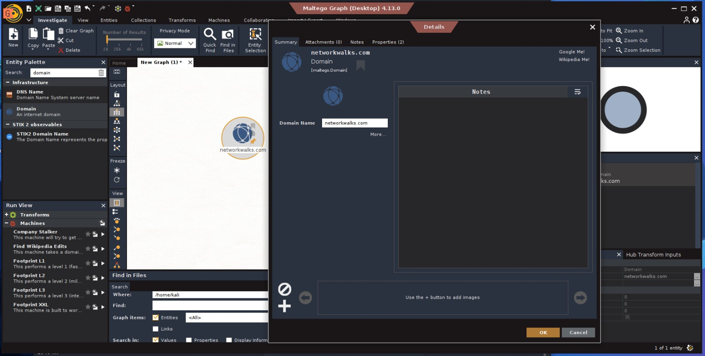
  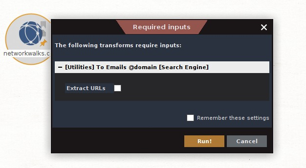
  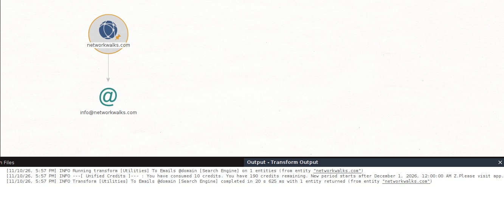

---

#### 4.1.4 theHarvester Based Footprinting Attacks (`W2-PM4`)

In the fourth module (**W2-PM4**), I utilized **theHarvester v4.11.1** in Kali Linux to passively enumerate email addresses, subdomains, and resolved IP addresses from public search engines and OSINT modules. Raw logs are saved in [`outputs_w2pm4/`](./outputs_w2pm4/).

##### Task 1: Targeted OSINT Harvesting via Baidu (Limit 1000)
- **Command Executed:**
  ```bash
  theHarvester -d microsoft.com -l 1000 -b baidu
  ```
- **Raw Output Log:** [`outputs_w2pm4/07_theharvester_baidu.txt`](./outputs_w2pm4/07_theharvester_baidu.txt)
- **Key Findings Observed:**
  - **Target:** `microsoft.com` | **Source:** `baidu` | **Limit:** `1000`
  - **Emails Found (`1`):** `'@microsoft.com`
  - **Hosts / Subdomains Found (`12`):** `account.microsoft.com`, `admin.exchange.microsoft.com`, `developer.microsoft.com`, `docs.microsoft.com`, `dotnet.microsoft.com`, `i.msdn.microsoft.com`, `learn.microsoft.com`, `o15.officeredir.microsoft.com`, `s.windows.microsoft.com`, `support.microsoft.com`, `ti.defender.microsoft.com`, and `turn.teams.microsoft.com`.
- **Evidence Screenshot (`14_theharvester_baidu.png`):**
  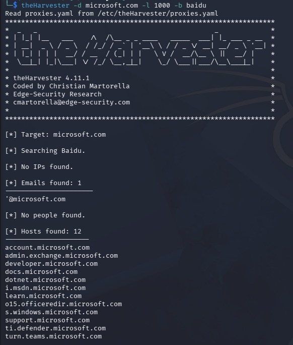

---

##### Task 2: Comprehensive Multi-Source OSINT Enumeration via All Sources (Limit 50)
- **Command Executed:**
  ```bash
  theHarvester -d microsoft.com -l 50 -b all
  ```
- **Raw Output Log:** [`outputs_w2pm4/08_theharvester_all.txt`](./outputs_w2pm4/08_theharvester_all.txt)
- **Key Findings Observed:**
  - **Target:** `microsoft.com` | **Source:** `all` | **Limit:** `50`
  - **Enumerated Subdomains & Resolved IPv4/IPv6 Addresses:** Extracted extensive staging, corporate, and production subdomains including `wus3s1-reprocessor-dcatbackend-int.staging.bigcatalog-int.commerce.microsoft.com`, `ww.alchemy.microsoft.com`, `wwwbeta.microsoft.com`, `wwwco2test62.microsoft.com:64:ff9b::86aa:b908` (IPv6), `wwwqa.microsoft.com`, `xbdprotopie.redmond.corp.microsoft.com`, `xbox.collections.commerce.microsoft.com`, `xeusinsightiq01.redmond.corp.microsoft.com`, `xflowservice-mixedreality.ptr.corp.microsoft.com`, `xonecert.core.microsoft.com`, `xplatmsg.prod.communication.microsoft.com`, `yahoo.ads.microsoft.com`, `yakko.buddy.microsoft.com:131.107.86.17`, `yanlltest.apbuilders.microsoft.com`, `yourchoice.microsoft.com`, `yt-fdv7.ppe.frontdoor.cloudcatalog.microsoft.com`, `zai-prod-mwh-proc.ait.microsoft.com`, `zebra-ai-api-prd.ait.microsoft.com`, and `zeus.buddy.microsoft.com:131.107.86.4`.
  - **API Key Inspection:** Checked `/etc/theHarvester/api-keys.yaml` across commercial OSINT modules (`SecurityScorecard`, `BuiltWith`, `bevigil`, `Bitbucket`, `bufferoverun`, `Brave Search`, `Censys`, `criminalip`, `Dehashed`).
- **Why This Matters to an Attacker:** Non-production and internal-facing subdomains (such as `staging`, `qa`, `dev`, `uat`, and `corp` hosts) often have weaker security controls than the main `www` portal, expanding the organization's external attack surface.
- **Evidence Screenshot (`15_theharvester_all.png`):**
  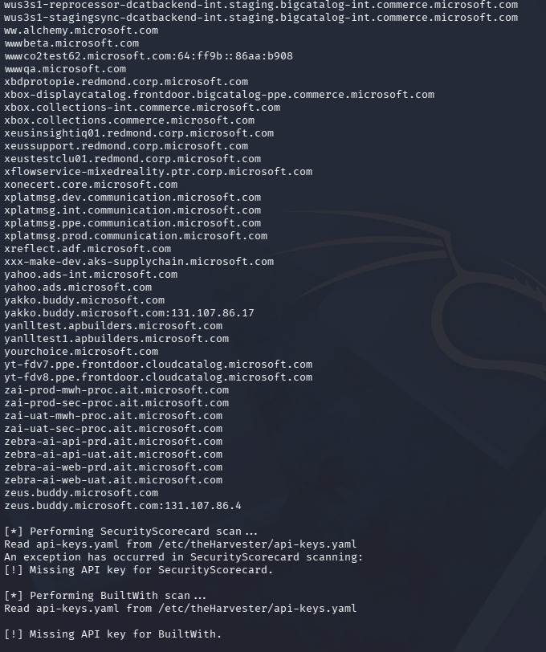

---

### 4.2 Phase 2: Network Scanning & Host Discovery (`W2-PM5`)

In the fifth module (**W2-PM5**), I performed active host discovery and topology mapping on my local area network (LAN) using **Windows Command Prompt (`ipconfig`)** and **Zenmap (Nmap v7.99 GUI)**.

#### Task 1 & Task 2: Zenmap Installation & Local Subnet Identification
- **Command Executed in Windows CMD (`C:\Users\angga>`):**
  ```cmd
  ipconfig
  ```
- **Key Network Configuration Identified (`Wireless LAN adapter Wi-Fi`):**
  - **IPv4 Address:** `192.168.100.3`
  - **Subnet Mask:** `255.255.255.0` (`/24` prefix)
  - **Default Gateway:** `192.168.100.1` (`fe80::1%15`)
  - **Target Local Subnet Range:** **`192.168.100.0/24`** (256 IP addresses)
  - *(Additional virtual adapters present: `VMware Network Adapter VMnet1` at `192.168.61.1/24` and `VMnet8` at `192.168.18.1/24`)*
- **Evidence Screenshot (`16_ipconfig_subnet.jpg`):**
  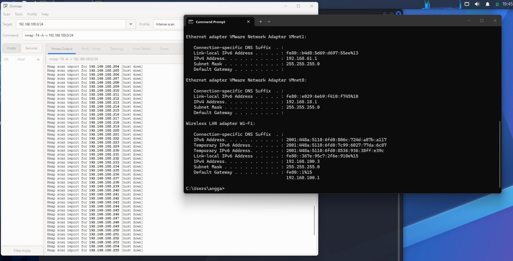

---

#### Task 3, Task 4, Task 5 & Task 6: Subnet Host Discovery (`Ping scan`), Live IPs & MAC Addresses
- **Zenmap Command Executed:**
  ```bash
  nmap -sn 192.168.100.0/24
  ```
- **Scan Execution Metrics:** `Starting Nmap 7.99 at 2026-11-11 07:57 +0700` -> `Nmap done: 256 IP addresses (8 hosts up) scanned in 6.54 seconds` (with 9 total active host entries populated in the session Hosts panel including `192.168.100.93`).

| Task | Module Question | Verified Scan Answer (`192.168.100.0/24`) |
| :---: | :--- | :--- |
| **Task 4** | **How many hosts are live in your subnet?** | **8 hosts are live** in the `nmap -sn 192.168.100.0/24` scan output (`256 IP addresses (8 hosts up) scanned in 6.54 seconds`), with a 9th intermittently active host (`192.168.100.93`) recorded in the Zenmap Hosts list & Topology graph. |
| **Task 5** | **What are the IP addresses of the live hosts?** | 1. `192.168.100.1` (Default Gateway / Router)<br>2. `192.168.100.3` (Local Scanning PC / `localhost`)<br>3. `192.168.100.4`<br>4. `192.168.100.6`<br>5. `192.168.100.16`<br>6. `192.168.100.19`<br>7. `192.168.100.23`<br>8. `192.168.100.24`<br>*(+ `192.168.100.93` in session host panel)* |
| **Task 6** | **What are the MAC addresses of the live hosts?** | 1. `192.168.100.1` — **`24:46:E4:E2:C9:A8`** (`Huawei Technologies`, `0.015s` latency)<br>2. `192.168.100.4` — **`5E:72:36:38:6E:51`** (`Unknown`, `0.10s` latency)<br>3. `192.168.100.6` — **`A2:0A:5E:48:97:35`** (`Unknown`, `0.010s` latency)<br>4. `192.168.100.16` — **`B0:FD:E8:09:06:8B`** (`Unknown`, `0.0050s` latency)<br>5. `192.168.100.19` — **`8A:66:65:42:1F:C0`** (`Unknown`, `0.072s` latency)<br>6. `192.168.100.23` — **`72:80:02:07:3B:05`** (`Unknown`, `0.058s` latency)<br>7. `192.168.100.24` — **`0C:9D:92:9C:A0:A2`** (`ASUSTek Computer`, `0.099s` latency)<br>8. `192.168.100.3` — **Local Host Wi-Fi MAC Address** (verified via `ipconfig /all`) |

- **Evidence Screenshot (`17_zenmap_ping_scan.png`):**
  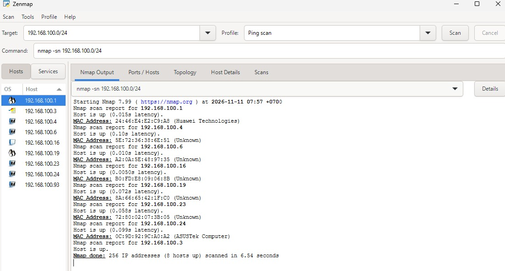

---

#### Task 7: Network Topology Visualization & PDF Export
- I opened the **Topology** tab in Zenmap, activated the **Topology Legend** window, and exported the radial network topology diagram centered around `localhost` (`192.168.100.3`) to PDF format.
- **Exported Topology PDF File:** [`Zenmap_Topology.pdf`](./Zenmap_Topology.pdf)
- **Why This Matters to an Attacker:** Active ARP/ICMP ping scans map every live system on a local segment in seconds and reveal hardware manufacturers via MAC OUI prefixes (`Huawei Technologies` gateway and `ASUSTek Computer` endpoint), allowing attackers to prioritize high-value targets.
- **Evidence Screenshot (`18_zenmap_topology.png`):**
  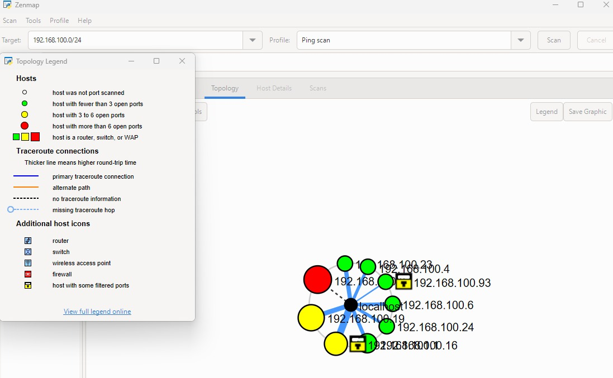

---

## 5. Risk Analysis & Potential Impact

The table below consolidates the technical risks identified across all five modules (`W2-PM1` to `W2-PM5`):

| # | Module | Risk / Technical Finding | Evidence / Observation | Potential Impact | Risk Level |
| :---: | :---: | :--- | :--- | :--- | :---: |
| **1** | W2-PM1 | **Web Server, CMS & Plugin Version Disclosure** | `whatweb` & `curl -I` disclosed `Apache`, `WordPress 7.1.4`, `WP Download Manager 3.3.76`, `Bootstrap 7.1.4`, and `jQuery 3.7.1`. | Attackers can match exact version numbers against public CVE databases to launch targeted exploits. | **Medium** |
| **2** | W2-PM1 | **WordPress REST API (`/wp-json/`) Publicly Accessible** | `curl -I` response header exposed `link: <https://networkwalks.com/wp-json/>; rel="https://api.w.org/"`. | Enables unauthenticated user enumeration, content metadata scraping, and targeted plugin API attacks. | **Medium** |
| **3** | W2-PM1 | **DNSSEC Not Configured (`unsigned`)** | `whois` (`DNSSEC: unsigned`) and `dnsrecon` (`DNSSEC is not configured`). | Domain is vulnerable to DNS spoofing and cache poisoning attacks without cryptographic record validation. | **Medium** |
| **4** | W2-PM1 | **DNS Server Version (`BIND`) & cPanel SRV Records Exposed** | `dnsrecon` revealed `BIND 9.16.23-RH` on HostGator name servers and `_autodiscover._tcp` SRV records pointing to cPanel. | Assists attackers in fingerprinting backend management infrastructure and targeting known BIND vulnerabilities. | **Low** |
| **5** | W2-PM1 | **SPF Record Configured with SoftFail (`~all`)** | `dnsrecon` extracted `v=spf1 a mx include:websitewelcome.com ~all`. | Weak SPF enforcement (`~all` instead of `-all`) combined with missing DMARC can permit email spoofing. | **Low** |
| **6** | W2-PM2 | **Unauthenticated Internet-Facing IP Cameras Exposed via GHDB** | Dork `intitle:"webcamXP" inurl:8080` and Axis dorks exposed 10 live security cameras (e.g., `http://109.233.191.130:8080/`). | Unauthorized physical surveillance, privacy breaches, and potential exploitation of camera firmware. | **High** |
| **7** | W2-PM2 | **Open Web Server Directory Listings Indexed by Google** | Dork `intitle:index.of "parent directory" mathematics pdf` exposed 10 browsable directories (e.g., `http://erewhon.superkuh.com/library/Math/`). | Unintended exposure of server directory structure and sensitive files placed inside indexed folders. | **Medium** |
| **8** | W2-PM3 & PM1 | **Organizational Email Address Harvestable via OSINT** | `whatweb` and Maltego (`[Utilities] To Emails @domain [Search Engine]`) extracted `info@networkwalks.com`. | Facilitates targeted spear-phishing, business email compromise (BEC), and credential stuffing attacks. | **Low** |
| **9** | W2-PM4 | **Staging, QA & Corporate Subdomains Exposed in Public OSINT** | `theHarvester` (`-b baidu` and `-b all`) enumerated 12+ Baidu hosts and numerous staging/corp subdomains & IPs. | Expands the external attack surface by revealing pre-production or internal hostnames (`staging`, `qa`, `corp`). | **Medium** |
| **10** | W2-PM5 | **Live Hosts & Hardware Vendor MACs Visible on Local LAN** | Zenmap (`nmap -sn 192.168.100.0/24`) discovered 8+ live hosts and vendor MAC OUIs (`Huawei Technologies`, `ASUSTek Computer`). | Local attackers or rogue devices can map active endpoints and target gateway/workstation hardware. | **Medium** |

---

## 6. Recommendations

Based on the findings across Phase 1 and Phase 2, the following remediation measures are recommended:

1. **Hide Software Version Banners & Suppress Meta Generators (`W2-PM1`):** Configure Apache (`ServerTokens Prod`, `ServerSignature Off`) and WordPress to remove version meta tags (`WordPress 7.1.4`, `WP Download Manager 3.3.76`) from public HTML and HTTP headers.
2. **Restrict Unauthenticated Access to WordPress REST API (`W2-PM1`):** Restrict `/wp-json/` endpoints to authenticated users only (or filter sensitive routes via the existing `ModSecurity` WAF) to prevent user and content enumeration.
3. **Enable DNSSEC, Hide BIND Version & Harden Email Authentication (`W2-PM1`):** Enable **DNSSEC** at the registrar (GoDaddy/HostGator), configure BIND to hide `version.bind` queries (`9.16.23-RH`), transition SPF from SoftFail (`~all`) to HardFail (`-all`), and enforce DKIM and DMARC policies.
4. **Secure Internet-Facing IoT Devices & Disable Directory Auto-Indexing (`W2-PM2`):** Place IP cameras behind a VPN or internal VLAN, enforce strong authentication on all management ports (`8080`/`80`), and disable web server directory browsing (`Options -Indexes` in Apache or `autoindex off;` in Nginx).
5. **Protect Public Contact Emails & Audit Subdomain Hygiene (`W2-PM3` & `W2-PM4`):** Replace plain-text email addresses (`info@networkwalks.com`) with protected contact forms, enforce Multi-Factor Authentication (MFA) on all accounts, and conduct periodic `theHarvester`/Maltego self-audits to decommission unused `staging` or `qa` subdomains.
6. **Enforce Internal Network Segmentation & Rogue Device Monitoring (`W2-PM5`):** Perform scheduled Nmap/Zenmap baseline scans on internal subnets (`192.168.100.0/24`), investigate unfamiliar MAC addresses immediately, and implement VLAN segmentation and 802.1X port security.

---

## 7. Conclusion

Completing all five Week 2 modules (**W2-PM1 through W2-PM5**) demonstrated how passive footprinting and active network scanning complement each other during a structured penetration test:
- Through **passive reconnaissance (`W2-PM1`–`W2-PM4`)**, I mapped the hosting provider (`HostGator`), IP address (`192.232.216.135`), web stack (`Apache`, `WordPress 7.1.4`, `WP Download Manager 3.3.76`), WAF defense (`ModSecurity`), DNS records (`BIND 9.16.23-RH`, `SPF ~all`, `DNSSEC: unsigned`), organizational email (`info@networkwalks.com`), exposed IoT/directory targets via GHDB, and multi-source subdomains via `theHarvester`.
- Through **active network scanning (`W2-PM5`)**, I identified the local LAN subnet (`192.168.100.0/24`) and enumerated 8 live hosts (plus `192.168.100.93`), their MAC addresses, hardware vendors (`Huawei Technologies` and `ASUSTek Computer`), and radial network topology in `6.54 seconds`.

Addressing the medium- and high-priority exposures—particularly restricting `/wp-json/`, suppressing version banners, enabling DNSSEC, disabling open directory indexing, and monitoring local subnet hosts—will substantially reduce the attack surface before moving into **Phase 3 (Vulnerability Assessment & Exploitation)**.
